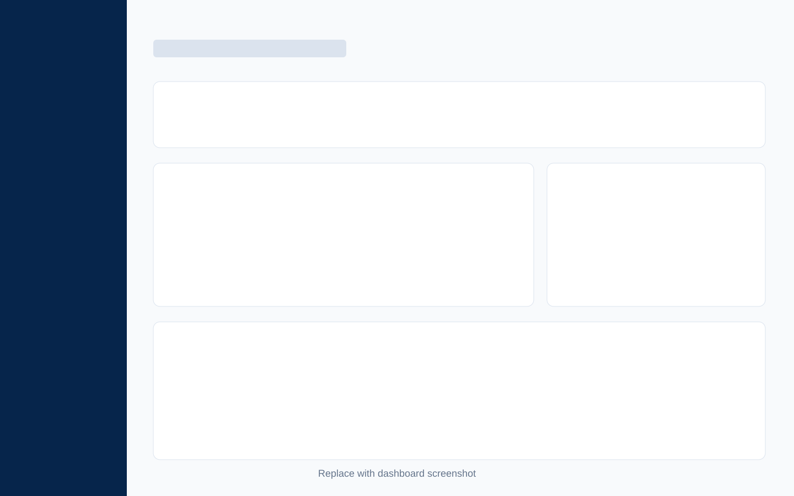
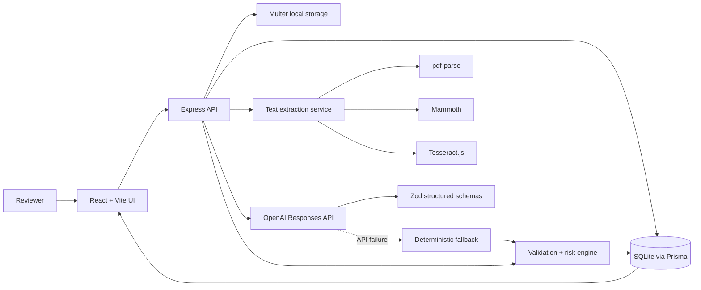
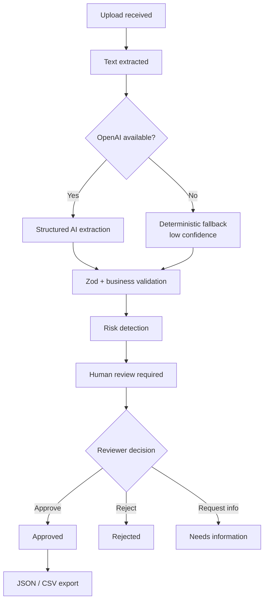
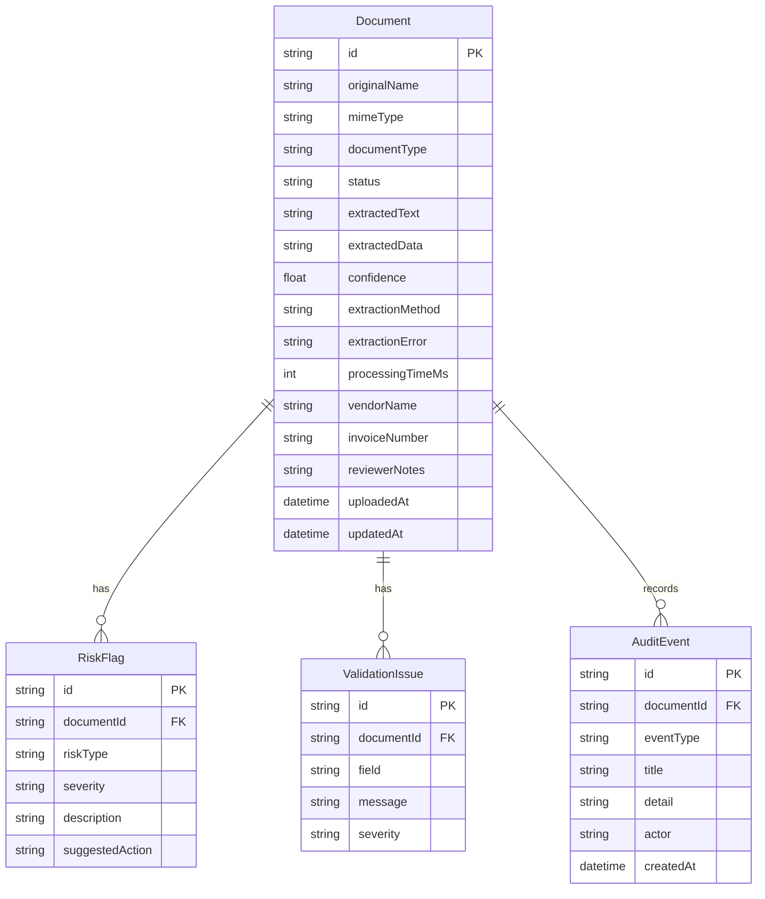

# DocuIntel — AI Document Intelligence Platform

A full-stack portfolio MVP that turns invoices, contracts, HR files and general business documents into validated, risk-aware, human-reviewed data.

DocuIntel demonstrates the work around an AI model call: file ingestion, text extraction, typed structured outputs, deterministic validation, risk rules, fallback behavior, review decisions, auditability and export.



## Why this project exists

Business teams still re-key high-volume documents into finance, legal and HR systems. That process is slow, inconsistent and difficult to audit. Pure “AI extraction” demos also miss the controls a real workflow needs.

DocuIntel makes each document review-ready:

- extracts text from PDF, DOCX and images;
- maps content into document-specific schemas;
- validates fields with deterministic business rules;
- flags operational and compliance risks;
- routes uncertain results to a human reviewer;
- records every important activity; and
- exports approved data as JSON or CSV.

### Target users

- Accounts payable and procurement teams
- Legal operations and contract managers
- HR operations teams
- Shared-service and automation teams

### Business value

- Less manual data entry
- Faster review turnaround
- Consistent control checks
- Clear exception queues
- Traceable human decisions
- Safer AI adoption through human-in-the-loop design

## Portfolio highlights

- **Real full-stack workflow:** React SPA, Express API, Prisma and SQLite
- **Backend-only AI:** OpenAI credentials never reach the browser
- **Structured Outputs:** Responses API extraction is constrained by Zod schemas
- **Resilient processing:** deterministic fallback extraction keeps work reviewable
- **Controls before automation:** validation and risk rules are separate, testable modules
- **Professional review UX:** source comparison, editable fields, risks, notes and audit timeline
- **Demo-ready data:** seeded invoices, contracts, HR records and failure scenarios

## Screenshots

Replace these placeholders with production screenshots after running the app.

| Dashboard | Review workspace |
| --- | --- |
|  |  |

## Tech stack

| Layer | Technology |
| --- | --- |
| Frontend | React 19, TypeScript, Vite, Tailwind CSS, shadcn/ui conventions |
| Server state | TanStack Query |
| Backend | Node.js, Express, Multer |
| Database | Prisma, SQLite |
| AI | OpenAI Responses API, Structured Outputs, Zod |
| Text extraction | pdf-parse, Mammoth, Tesseract.js |
| Testing | Vitest |
| Packaging | Docker |

## Architecture



The browser communicates only with the Express API. Files, database access and `OPENAI_API_KEY` remain on the backend.

## Processing pipeline



Every completed stage creates an audit event. Extraction errors are stored and surfaced rather than disappearing into logs.

## AI safety and human review

- Model output is treated as a proposal, never as an automatic approval.
- Structured Outputs constrain the response shape.
- Source document content is treated as untrusted data, not instructions.
- `store: false` is used for Responses API calls.
- Deterministic rules independently verify dates, amounts and required identifiers.
- Low confidence, missing fields and high-risk conditions are visible to reviewers.
- Reviewers can correct fields and add notes before approval.
- All decisions and exports are recorded in the audit timeline.

## Validation strategy

Examples implemented in `server/domain/validation.ts`:

- invoice number is required;
- total amount must be greater than zero;
- invoice date cannot be in the future;
- due date cannot precede the invoice date;
- VAT cannot be negative;
- contracts need at least two parties;
- HR documents need an employee name or number; and
- action-based documents need required actions.

## Risk strategy

Examples implemented in `server/domain/risks.ts`:

- missing invoice number or bank details;
- duplicate invoice number for the same vendor;
- high-value payment threshold;
- future-dated document;
- expired contract;
- missing signature marker;
- missing employee identifier; and
- low extraction confidence.

Each risk has a type, severity, description and suggested reviewer action.

## Database schema



`extractedData` is stored as serialized JSON so the SQLite MVP can support different schemas without a wide sparse table. Searchable invoice fields are also denormalized onto `Document`.

## API

Base URL: `http://localhost:3001/api`

| Method | Endpoint | Purpose |
| --- | --- | --- |
| `GET` | `/health` | Service health check |
| `GET` | `/dashboard` | Metrics, recent documents and review queue |
| `GET` | `/documents` | Search/filter documents by `search`, `type`, `status`, `risk` |
| `GET` | `/documents/:id` | Full document, issues, risks and audit timeline |
| `GET` | `/documents/:id/source` | Locally stored source file |
| `POST` | `/documents` | Multipart upload using field `file`; optional `documentType` |
| `PATCH` | `/documents/:id` | Save corrected `extractedData` and `reviewerNotes` |
| `POST` | `/documents/:id/decision` | Set `APPROVED`, `REJECTED` or `NEEDS_INFO` |
| `GET` | `/documents/:id/export?format=json` | Download JSON export |
| `GET` | `/documents/:id/export?format=csv` | Download CSV export |

Example decision request:

```json
{
  "status": "APPROVED",
  "reviewerNotes": "Matched totals and confirmed supplier details."
}
```

## Run locally

### Requirements

- Node.js 20.19 or newer
- npm 10 or newer
- An OpenAI API key for live AI extraction (optional for seeded demos and fallback mode)

### Quick start

```bash
git clone <your-repository-url>
cd ai-document-intelligence-platform
npm install
copy .env.example .env.local
npm run dev
```

On macOS/Linux use `cp .env.example .env.local`.

`npm run dev` creates the SQLite schema through an idempotent Prisma bootstrap and seeds it only when the database is empty. Open [http://localhost:5173](http://localhost:5173).

### Environment variables

```dotenv
PORT=3001
OPENAI_MODEL=gpt-5.4-mini
OPENAI_API_KEY=your_key_here
```

The key is optional. Without it, uploads use the deterministic fallback and remain available for manual review. Never use a `VITE_` prefix for server secrets.

## Useful commands

```bash
npm run dev          # web + API, with first-run database setup
npm run build        # TypeScript and production frontend build
npm test             # business-rule test suite
npm run typecheck    # TypeScript only
npm run lint         # ESLint
npm run db:seed      # reset and recreate demo data
npm run db:studio    # inspect SQLite with Prisma Studio
```

## Testing

The Vitest suite covers:

- validation rules;
- risk detection;
- allowed document status transitions;
- deterministic fallback extraction; and
- JSON/CSV formatting.

Run:

```bash
npm test
```

For a full pre-review check:

```bash
npm run typecheck
npm test
npm run build
```

## Demo workflow

1. Start on the dashboard and open the pending **Acme Office Supplies** invoice.
2. Compare extracted data with the source.
3. Review the missing purchase order and bank-details risks.
4. Edit a field and add a reviewer note.
5. Approve the document.
6. Export JSON or CSV.
7. Return to Documents and filter by high risk.

A complete talk track is in [docs/demo-script.md](docs/demo-script.md).

## Docker

For the Vercel frontend plus a persistent backend, see [deployment instructions](docs/deployment.md).
Deploying only the Vite build does not run the document API.

```bash
docker build -t docuintel .
docker run --env-file .env.local -p 3001:3001 docuintel
```

The production image serves the built frontend and API from port `3001`.

## Known limitations

- Local filesystem storage is development-only and not suitable for horizontal scaling.
- SQLite is ideal for the MVP, not high-concurrency production workloads.
- OCR quality depends on image clarity and English-language recognition.
- Duplicate checks use vendor and invoice number, not fuzzy entity resolution.
- Processing runs in the request lifecycle rather than a durable job queue.
- Authentication and role-based permissions are intentionally out of MVP scope.
- CSV export flattens top-level fields; nested values are serialized as JSON strings.

## Roadmap

1. Object storage and background job processing
2. Authentication, roles and reviewer assignment
3. Configurable validation/risk rule builder
4. Field-level confidence and source bounding boxes
5. Webhooks and ERP/DMS connectors
6. Evaluation dataset, extraction accuracy metrics and prompt versioning
7. PostgreSQL and deployment observability

## Recruiter-facing summary

This project demonstrates an automation specialist’s ability to design the entire operational system around AI: reliable ingestion, typed extraction, failure handling, deterministic controls, human decision points, audit trails, export contracts, tests and a polished user experience. It is intentionally an MVP, but its boundaries and next production steps are explicit.

## License

MIT
